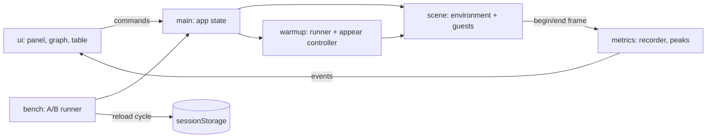
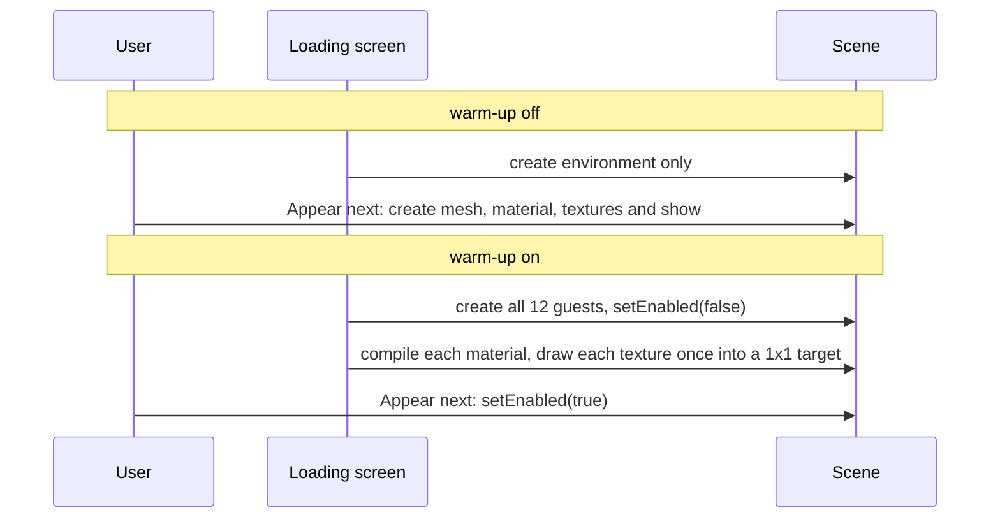
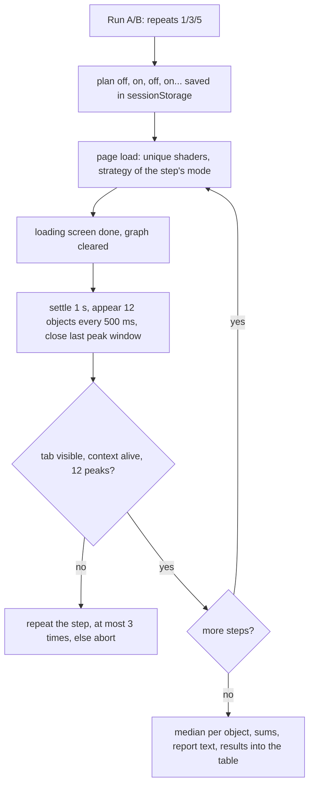

# Architecture

A single static page (no backend) that renders one Babylon.js scene in two modes, **warm-up off** and **warm-up on**, and records frame times while 12 objects ("guests") appear one by one. The difference between the modes is the point of the demo.

## Modes

## Run A/B

Every switch (mode, parallel compile) and every A/B step is a page reload, so each measurement starts with an empty engine. `ResultsStore` and the A/B session live in `sessionStorage` and carry the numbers across reloads.

## Directories

| Path            | Purpose                                                                                     |
| --------------- | ------------------------------------------------------------------------------------------- |
| `src/scene`     | Environment (floor, camera, base light) and the 12 guest factories                          |
| `src/warmup`    | Material compilation, texture warm-up, appearance control                                   |
| `src/metrics`   | Frame recorder, ring buffer, peak windows, A/B report                                       |
| `src/bench`     | A/B plan and session, one benchmark step, median and report text                            |
| `src/app`       | URL settings, results store, storage seam                                                   |
| `src/ui`        | DOM panel, canvas-2D frame graph, peaks table, styles                                       |
| `src/util`      | Small shared helpers (typed event emitter)                                                  |
| `src/env`       | GPU and browser detection                                                                   |
| `scripts`       | Offline texture generation (PNG, KTX2 through `toktx`)                                      |
| `public`        | Generated textures (`textures/`) and the self-hosted KTX2 decoder and transcoders (`ktx2/`) |
| `tests` / `e2e` | Jest unit tests / Playwright page-flow tests                                                |

## Boundaries

- `ui/` talks to the engine side only through typed events and app state; it never touches Babylon objects.
- Guests are isolated: extra lights and shadows apply only to their own meshes, so one guest never changes another guest's shader variant.
- Shader code is imported statically (`scene/shaders.ts`): Babylon would otherwise fetch it with a dynamic `import()` on first use, and the first appearance of every material would measure a network request instead of a shader compile.
- One `Engine` per page life. Switching parallel compile and every A/B run reload the page; shaders are made unique per run so the driver's program cache cannot make the cold path look warm.
