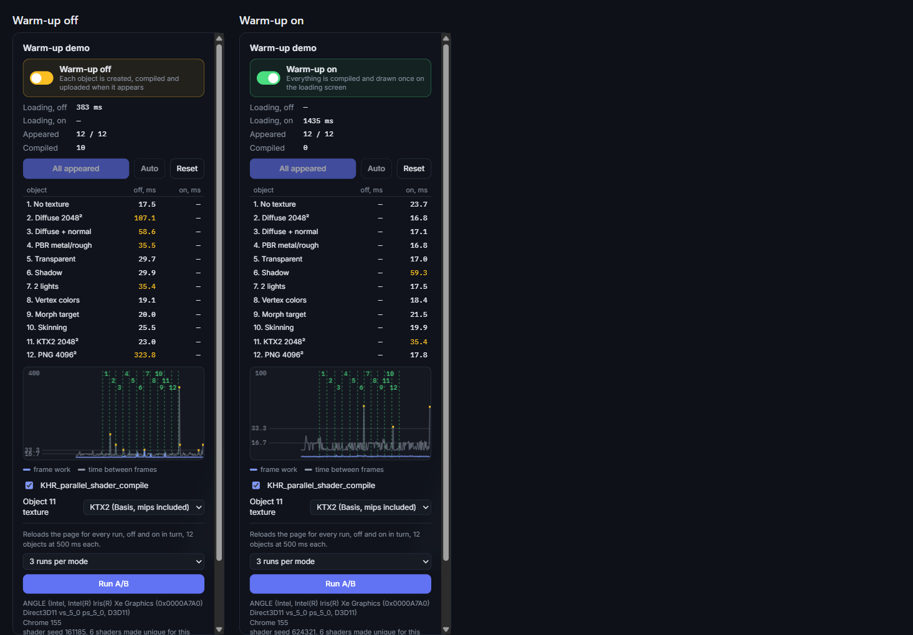

# Kiln

Texture and shader warm-up for browser 3D: every material and texture goes through the kiln before it enters the scene.

Why does a 3D scene in the browser stutter the first time a new object appears, and never again? Because the GPU had not seen it yet. This page shows the same 12 objects appearing in one Babylon.js scene with and without **warm-up**, and plots the frame time so the difference is a spike or no spike.

**Live demo:** https://d1i.github.io/kiln/



## What it shows

Every object in the scene needs something the engine has not done yet: a shader variant to compile and link, a texture to upload and mipmap, a shadow map to render for the first time. Without warm-up all of that happens on the first frame that shows the object. With warm-up it happens on the loading screen, and showing the object is `setEnabled(true)`.

The 12 objects appear one by one (button, or every 500 ms on the timer). Each one needs a variant of the shader or the texture path that none of the earlier ones used:

| #   | Object                 | What is new for the engine                                                         |
| --- | ---------------------- | ---------------------------------------------------------------------------------- |
| 1   | No texture             | the base lit shader                                                                |
| 2   | Diffuse 2048²          | a texture to upload and mipmap (16 MB of RGBA)                                     |
| 3   | Diffuse + normal       | the bump-map variant, two textures                                                 |
| 4   | PBR metallic/roughness | the PBR shader, two textures                                                       |
| 5   | Transparent            | alpha blending, its own pass                                                       |
| 6   | Shadow                 | a shadow generator: the depth shader, a shadow map, a PCF receiver                 |
| 7   | 2 lights               | a variant with a second light                                                      |
| 8   | Vertex colors          | the vertex-colour variant                                                          |
| 9   | Morph target           | two morph influencers                                                              |
| 10  | Skinning               | a two-bone skeleton                                                                |
| 11  | KTX2 2048²             | a Basis texture whose mip chain is already in the file; switchable to its PNG twin |
| 12  | PNG 4096²              | a 4096² PNG to decode, upload (64 MB) and mipmap                                   |

The extra light and the shadow generator are restricted to their own object (`includedOnlyMeshes`), so adding one never changes the shader variant of another object. Otherwise object 7 would silently recompile everything else and the comparison would mean nothing.

## Using it

- **Warm-up on / off** (the switch) reloads the page in the other mode. The numbers of the first mode stay in the table.
- **Appear next** shows the next object, **Auto** shows them every 500 ms, **Reset** clears the mode's column and reloads, so the next run starts cold.
- The table shows the **peak** per object: the worst frame (see below) within half a second of its appearance. **Compiled** counts the shader programs the engine built after loading finished; with warm-up on it is 0.
- **KHR_parallel_shader_compile** can be turned off (it is disabled where the browser has no such extension), and object 11 can use KTX2 or PNG.
- **Run A/B** goes through off and on in turn, 1, 3 or 5 times each, by reloading the page, and prints the sum of the peaks, the largest peak and the loading time of both modes, plus a line per object. **Copy result** puts the text on the clipboard.

URL parameters: `?mode=on|off&parallel=0|1&texture=ktx2|png`.

## Numbers

**Hosted page, a browser tab on a 120 Hz display.** Windows 11, Intel Iris Xe (ANGLE / Direct3D 11), Chrome 156, 1536×770, KTX2, parallel compile on, **Run A/B** with 3 runs per mode, median per object. This is the page as deployed, after the texture prefetch and the peak-window fix described under _The measurement_:

|                              | Warm-up off        | Warm-up on |
| ---------------------------- | ------------------ | ---------- |
| Sum of peaks over 12 objects | 877 ms             | 141 ms     |
| Largest peak                 | 415 ms (PNG 4096²) | 16 ms      |
| Loading screen               | 224 ms             | 1795 ms    |

Peak per object, ms (off → on): no texture 20 → 10; diffuse 2048² 151 → 11; diffuse + normal 71 → 11; PBR 68 → 16; transparent 15 → 11; shadow 32 → 11; 2 lights 27 → 11; vertex colors 18 → 12; morph target 19 → 10; skinning 30 → 13; KTX2 2048² 12 → 12; PNG 4096² 415 → 12. The "on" column is twelve ordinary frames; on a 120 Hz display the floor is 8.3 ms.

**Earlier sessions, headless, localhost.** Same machine, 1600×1000, taken before the two measurement fixes (the texture bytes came over localhost, so the network did not matter, and the stall of the 4096² PNG fitted inside the window). Each row is one **Run A/B** with 5 runs per mode, the median per object. The runs were driven by Playwright in headless Chrome 155 and Edge 156; the page is the same one you get in a browser tab, but headless Chrome is not locked to the display's refresh rate, so the floor of the "on" peaks is the plain frame time of about 9 ms.

| Session                                | Warm-up off: sum of peaks / max peak | Warm-up on: sum of peaks / max peak | Loading, off → on |
| -------------------------------------- | ------------------------------------ | ----------------------------------- | ----------------- |
| Chrome 155, KTX2, parallel compile on  | 470 ms / 215 ms                      | 109 ms / 9.8 ms                     | 145 → 780 ms      |
| Edge 156, KTX2, parallel compile on    | 625 ms / 263 ms                      | 117 ms / 11.8 ms                    | 203 → 1250 ms     |
| Chrome 155, KTX2, parallel compile off | 638 ms / 206 ms                      | 106 ms / 9.1 ms                     | 149 → 1083 ms     |
| Chrome 155, PNG, parallel compile on   | 657 ms / 257 ms                      | 107 ms / 9.8 ms                     | 153 → 939 ms      |

The "on" sum is 12 frames of about 9 ms; there is nothing left to remove. Peak per object in the first session (ms, off → on):

| Object              | off → on       | Object           | off → on    |
| ------------------- | -------------- | ---------------- | ----------- |
| 1. No texture       | 14.2 → 8.8     | 7. 2 lights      | 9.0 → 9.2   |
| 2. Diffuse 2048²    | **82.3 → 8.9** | 8. Vertex colors | 8.8 → 9.0   |
| 3. Diffuse + normal | 38.5 → 9.2     | 9. Morph target  | 20.0 → 8.9  |
| 4. PBR metal/rough  | 33.4 → 8.9     | 10. Skinning     | 9.8 → 9.0   |
| 5. Transparent      | 8.8 → 9.1      | 11. KTX2 2048²   | 13.8 → 9.0  |
| 6. Shadow           | **17.0 → 9.6** | 12. PNG 4096²    | 214.8 → 9.8 |

What to read from them, and what not:

- **The textures are the big spikes.** A 2048² diffuse costs 80-110 ms in the four sessions, a 4096² PNG over 200 ms. The decode, the upload and the mip chain all land on one frame.
- **KTX2 against PNG, same picture:** 14-22 ms against 85 ms for object 11 without warm-up. The KTX2 file carries every mip level, so nothing is generated on the user's machine; the PNG twin needs a decode and the GPU's `generateMipmap`.
- **The shadow material varied the most between sessions**: 17, 26, 28 and 89 ms. The 89 ms one is the session with parallel compile off, where the shader link blocks the frame. That fits how the extension works: with it the engine keeps rendering while the program links and the object appears a few frames later, so the stall is smaller. One session each is not proof, and the peak measures the stall, not the delay before the object is visible.
- **Noise is real.** A first Chrome session, taken while a build was running in the background, came out at 888 ms / 289 ms against 215 ms / 30 ms; it was discarded and repeated on an idle machine. Any single appearance can have a spike that has nothing to do with it. That is why Run A/B takes a median over repeats, repeats a step when the tab went to the background or the context was lost, and why the table is a snapshot rather than a verdict.
- **Warm-up is not free.** The loading screen is 0.6-1.0 s longer here, and every object's textures and programs sit in memory whether the user ever looks at them. Which is why warm-up is a list, not a loop: the assets of the first minute, nothing else.
- Only one machine so far. The page prints its GPU and browser into the result; if you run **Run A/B** on yours, I would like to see the text.

## How it works

**Warm-up on** does this on the loading screen, for all 12 objects (`src/warmup/warmupRunner.ts`):

1. waits until every texture is downloaded and decoded;
2. compiles and links every material with `forceCompilationAsync`, all at once, so with `KHR_parallel_shader_compile` the compiles overlap; the shadow generator's depth shader is compiled too;
3. draws every object once into a 1×1 offscreen `RenderTargetTexture` (the shadow map first). That is the step that makes the driver do what it postpones until first use: upload and mip chain of the textures, pipeline state, the shadow map. A pixel read-back at the end waits for the GPU, so nothing is still queued when the loading screen goes away.

Objects are hidden with `setEnabled(false)` during all this and enabled by the button.

**Warm-up off** builds the object, its material and its textures at the moment it appears.

### The measurement

- Two clocks per frame, drawn as two lines. _Frame work_ is `performance.now()` from `beginFrame` to `endFrame`: what the main thread spent. _Time between frames_ is the distance between consecutive `beginFrame`s: it also shows a stall that lands after `endFrame` (a texture decoded between frames, a GPU wait). The peak in the table is the larger of the two.
- A peak window opens when an object is about to appear and closes after 500 ms or when the next object appears, whichever is first, so a spike is attributed to exactly one object.
- The graph keeps the last 1200 frames and draws the worst frame of every pixel column, so no spike is lost when 12 appearances (6 s, which is 360 frames at 60 Hz and over 850 at 144 Hz) are squeezed into 300 pixels. The brief asked for 300 frames; that did not fit all 12 appearances on a high-refresh display.
- **Every run starts cold.** Switching the mode and every step of Run A/B reload the page. A reload alone is not enough: drivers and Chromium keep an on-disk cache of compiled shader programs, so a second load would find its shaders already built and the "off" path would look cheaper than it is. Each page load therefore appends a statement with a literal that is new every time (about `1e-30` added to `gl_Position.w` and `gl_FragColor.r`) to the shaders in use, so the translated source never matches a cached one. The panel prints the seed and how many shaders were changed.
- The texture files are fetched on the loading screen in both modes and handed to Babylon.js as buffers, so the network is in neither mode's peaks. What "warm-up off" pays on the first frame is the decode, the upload and the mip chain. On localhost this changes nothing; on the hosted page a 16 MB download used to land in the peak of whichever object appeared while it arrived.
- Shader code is imported statically (`src/scene/shaders.ts`). Babylon.js fetches shaders with a dynamic `import()` on first use, which would put a network request into the first appearance of every material.
- The KTX2 decoder and the Basis transcoders are served from `public/ktx2`, not from the Babylon CDN: no third-party request inside a measurement.
- "Loading" is the time from the start of the page's own initialisation to the first rendered frame after warm-up. The download of the script is not in it.

## Running it

```sh
npm install
npm run dev               # http://localhost:5173
npm run build && npm run preview

npm run typecheck && npm run lint && npm test   # 48 unit tests
npm run test:e2e          # Playwright, headless Chromium on SwiftShader (checks the flow, not milliseconds)
```

The generated textures (25.9 MB) and the KTX2 decoder files are in the repository, so nothing else is needed. To regenerate them: `npm run gen:textures` (needs `toktx` from [KTX-Software](https://github.com/KhronosGroup/KTX-Software) on the `PATH`) and `npm run fetch:ktx2-decoder`.

Numbers taken on a software renderer (SwiftShader, which the end-to-end tests use) say nothing about GPUs. Use a browser with hardware acceleration.

## Project layout

```
src/scene       environment, the 12 guests (one factory each), shader and KTX2 setup
src/warmup      appearance control, the lazy and the eager strategy, the warm-up runner
src/metrics     frame recorder, ring buffer, peak windows
src/bench       A/B plan and session, one benchmark step, median and report text
src/app         URL settings, results store
src/ui          the panel, the frame graph, the peaks table
scripts         texture generation, KTX2 encoding, decoder copy
tests / e2e     Jest (pure logic) / Playwright (page flow)
```

`ARCHITECTURE.md` has the diagrams.

## Next steps

Out of scope here, and where this goes next:

- **Texture streaming.** Warm-up pays for everything up front. Streaming loads the first mips and refines, which turns a long loading screen into a short one and a few small uploads.
- **Texture atlases.** One texture, one upload, one binding for many objects, so there is less to warm up in the first place.
- **WebGPU.** Pipelines are objects created explicitly, `createRenderPipelineAsync` compiles without blocking the main thread, and the whole "first draw does the work" behaviour looks different. Worth the same experiment.

## License

MIT
